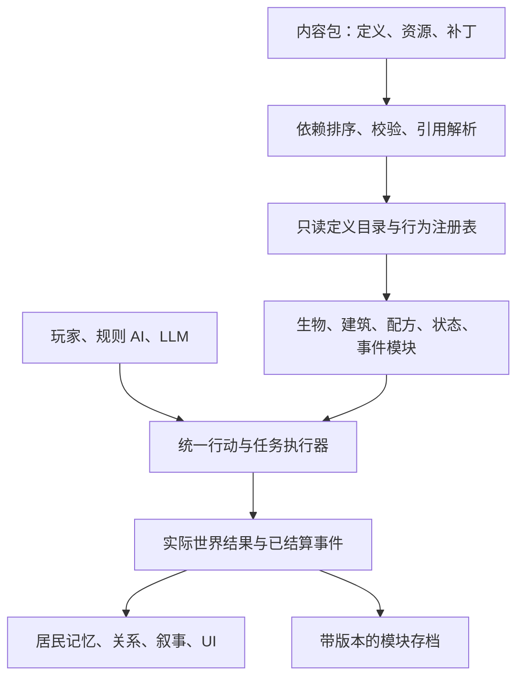

# RimWorld 扩展架构调研与 NoDwarf 建议

日期：2026-10-30。研究范围：框架作者公开文档、本机 RimWorld 1.6.4871 rev595 的 XML 与局部 DLL 实现，以及当日 NoDwarf 工作区（存档版本已为 28）。本文主体保留调研时的建议。后续四项基础设施已按首批范围接入（存档 29），实现、验收与剩余范围见 [开发版本计划](开发版本计划.md) 和 [源码说明](../source/README.md)。

核心建议：沿着现有生产定义、生物目录、行为注册表和受校验行动接口，建立一致的内容加载、行为组合、事件通知和存档协议。每次用一个真实玩法验证扩展能力，再扩大范围。

## 一、本体中值得学的系统

| 系统 | 已核查的机制 | 对 NoDwarf 的意义 |
| --- | --- | --- |
| Def／XML 定义 | 内容有稳定名称；例如电力建筑 XML 用 ParentName 继承、comps 指定能力；事件定义独立指定执行类、类别和概率参数 | 将物品、建筑、生物、配方等定义与实例状态分离；内容包引用稳定 ID |
| ThingComp／CompProperties | 组件持有宿主和配置，提供初始化、生成、销毁、伤害、存档及不同频率更新等入口 | 建筑和生物按需组合能力，复用供能、容器、温度影响等行为 |
| ThinkTree | 人形居民 XML 使用条件、优先级和 JobGiver 节点组织任务选择 | 生存规则、玩家命令、普通工作、人格偏好分层仲裁；LLM 接入选任务的环节 |
| JobDriver／Toil | 任务有预约入口、步骤序列、失败条件、清理；保存当前步骤与剩余时间，读档后重建步骤 | 统一处理任务取消、目标消失、资源释放与断点恢复 |
| StorytellerDef／IncidentDef | 叙事节奏参数与具体事件执行分开；事件带类别、目标标签、再触发间隔等配置 | 一个事件执行器可同时供规则导演、LLM 导演与测试调用 |
| Scribe／ExposeData | 保存与载入具有不同阶段，包括变量读取、引用解析、读档后初始化 | 内容定义 ID 与运行实体 ID 分开；先恢复对象，再恢复相互引用和运行任务 |

本体依据为安装目录 `RimWorldMac.app/Data/Core/Defs/` 中的 `ThingDefs_Buildings/Buildings_Power.xml`、`ThinkTreeDefs/Humanlike.xml`、`Storyteller/Storytellers.xml` 和 `Storyteller/Incidents_Map_Misc.xml`；局部反编译核查 `Verse.ThingComp`、`Verse.AI.JobDriver`、`Verse.Scribe`。工作文件放在 Git 忽略的 `work/research/rimworld-frameworks/`，没有把 RimWorld 引擎代码加入项目。以上结论限定于本机版本，不据此声称所有新版本 API 相同。

组件组合并不要求把游戏改成 ECS。尤其我们有多层体素地图：静态地形继续用紧凑数据；具有活动状态的建筑、生物和设备再按需挂组件，避免给每个方块都分配对象和每帧回调。

## 二、社区框架有哪些

| 框架 | 提供什么 | 适合借鉴什么 |
| --- | --- | --- |
| [Harmony](https://harmony.pardeike.net/articles/intro.html) | 运行时修改 .NET 方法，支持前置、后置和 IL 修改；自身不负责把 Mod 加载进游戏 | 了解扩展点不足时 Mod 作者如何补救；我们有源码，应优先提供正式 API |
| [HugsLib](https://github.com/UnlimitedHugs/RimworldHugsLib#current-features) | Mod 初始化／地图加载等生命周期、设置、日志、存档辅助和错峰定时回调 | 统一模块入口、设置与诊断；低频任务错峰执行 |
| [Vanilla Expanded Framework](https://github.com/Vanilla-Expanded/VanillaExpandedFramework/wiki) | 动物、建筑、服饰、健康、事件等共享行为；另有 MVCF 多攻击方式、KCSG 结构生成和 PipeSystem 管网 | 按玩法领域提供可复用模块，内容包通过定义组合它们 |
| [Humanoid Alien Races](https://github.com/erdelf/AlienRaces/wiki) | 用 XML 定义类人生物的外观、身体附加图层、背景、思想、关系和装备／研究等限制 | 种族差异放到定义和能力规则中，复用人物系统；身体结构与显示尺寸分开 |
| [XML Extensions](https://github.com/15adhami/XmlExtensions/wiki) | 更多 XML 补丁操作、用 XML 创建设置菜单、补丁错误追踪 | 定向覆盖字段、条件兼容和明确报错，显示配置来自哪个包及哪次修改 |
| [Vehicle Framework](https://github.com/SmashPhil/Vehicle-Framework) | 载具实体、专用寻路、组件化生命值、炮塔、起降、外观及兼容入口；框架本身不附送可玩载具 | 框架与内容分开；轮式、步行、飞行等运动能力需有自己的规则适配 |
| [JecsTools](https://github.com/jecrell/JecsTools) | 技能施放、激活效果、格挡、物品插槽等组件 | 为后续魔法、附魔、镶嵌提供组合思路；本次没有验证其最新游戏版本兼容性 |

这里的“可借鉴”是设计判断，不表示这些依赖 RimWorld 类型的框架能直接接进 Godot 项目。Harmony 是通用 .NET 库，其余多为 RimWorld 专用能力；也不需要为了我们的独立游戏要求玩家安装 RimWorld。

VEF 的 [OptionalFeatures](https://github.com/Vanilla-Expanded/VanillaExpandedFramework/wiki/OptionalFeatures) 允许模块在有内容包请求时才启用，适合避免“支持很多功能就默认承担所有开销”。其作者同时明确提示 1.6 命名空间变更会破坏部分旧 XML／C# Mod，说明公共名称与迁移规则必须提前考虑。[VEF 版本提示](https://github.com/Vanilla-Expanded/VanillaExpandedFramework)。

VEF 文档已把旧 Item Processor 标为过时，指向 PipeSystem 的 Advanced Resource Processor。后续研究加工扩展时应看当前入口，不沿用旧教程中的模块名。[VEF 文档目录](https://github.com/Vanilla-Expanded/VanillaExpandedFramework/wiki)。

## 三、我们现在已经有什么

| 当前基础 | 下一步缺口 |
| --- | --- |
| [ProductionDefinitions](../source/Simulation/ProductionDefinitions.cs) 从 XML 加载物品、配方和制造方式，并校验引用 | 当前是单份定义加载；需要内容包发现、依赖排序、来源记录和明确覆盖规则 |
| [CreatureCatalog](../source/Simulation/CreatureDefinitions.cs) 已分离身体、移动、物种、显示和能力 | 保留这个边界，向其他领域推广稳定 ID 和注册契约，不再另造一套生物系统 |
| [CreatureBehaviorRegistry](../source/Simulation/CreaturePopulation.cs) 已有注册行为、预算、随机状态与移动复核 | 统一注册入口与生命周期；把相同约定应用到居民任务、建筑能力和事件 |
| [HealthConditions](../source/Simulation/HealthConditions.cs) 已有状态定义、阶段和效果组合 | 定义目前仍主要写在 C# 表中；逐项开放可验证的数据配置即可，不必重写现有结算 |
| [ResidentActions](../source/Simulation/ResidentActions.cs) 和 [StoryEvents](../source/Simulation/StoryEvents.cs) 已有行动／事件入口 | 类型派发仍有集中 switch；新增行为应能注册，并复用预约、执行、失败和清理流程 |
| [ResidentMindDirector](../source/Services/Llm/ResidentMindDirector.cs) 已把模型选择与实际执行分开 | 用统一行动目录提供候选及条件，逐步减少额外维护的一份 AI 工具列表 |
| [ConsoleLua](../source/Scripts/ConsoleLua.cs) 已有受限 Lua 控制台和执行预算 | 它目前不是完整 Mod 脚本系统；还缺模块发现、事件订阅、生命周期和模块自己的持久化数据 |
| [WorldArchive](../source/Simulation/WorldArchive.cs) 有版本迁移；生物有定义指纹检查 | 增加内容包清单和模块数据版本，区分外观修改与身体／行为结构变化的兼容策略 |

另外，现有地形变更通知、日志通知和叙事事件队列各有用途，尚不能等同于贯穿照料、战斗、物品、记忆等领域的统一“已结算事实”协议。

## 四、建议推进顺序

### 第一优先：统一内容包和定义加载

用现有 `production.xml`、`creatures.xml` 做第一批真实用户。内容包清单至少包括包 ID、版本、所需 API 版本、依赖和可选依赖。加载时做依赖排序、循环检查、重复 ID 检查、引用解析，并保存每条定义的来源。

新增内容使用带包前缀的稳定 ID，例如 `my_pack:healing_herb`。现有 ID 保持兼容，通过别名或显式迁移扩展，不能为了统一命名直接改坏存档。

配置修改先提供少量明确操作：添加定义、设置字段、追加集合项、禁用定义。同一字段被多个包修改时记录顺序和来源；不静默整份覆盖。加载完成后生成只读目录，模拟期间不随意变动定义。

验收：增加一种药草／配方不改核心代码；未知物品引用报出包、文件、定义和字段；两个包冲突可解释；没有启用的模块不注册更新任务。

### 第二优先：统一任务执行契约

保留当前外部命令入口，先把送饭或护理迁移成一个可复用任务实现，而不是同时重写全部工作。

```text
选择任务 → 校验条件 → 预约对象／资源 → 前往 → 执行 → 提交结果 → 释放预约
                                         ↘ 中断／失败 → 清理与反馈
```

玩家、规则 AI、人格 AI 都提出同一种结构化意图。执行器统一管理目标、资源、步骤、取消原因、存档位置与完成回执。LLM 不负责逐格移动，也不能用一段文字绕过资源结算。

验收：送饭中途断路、取消、伤员死亡或读档，不丢失／复制口粮，不遗留预约；新增一个任务不需要改动多处 UI、AI 和模拟派发表。

### 第三优先：发布带身份的已结算事件

建议事件含 `eventId`、类型、版本、模拟时间、行动者、对象、结果和可知范围。一次治疗完成后，医疗系统先提交事实，记忆、关系、通知、成就和叙事系统再分别消费，避免每个模块互相直接调用。

监听者产生的新行动进入下一轮受校验的命令队列，避免递归修改正在结算的世界。事件订阅顺序、异常处理与去重规则要明确。全局诊断记录与居民自己知道的事分开，避免私聊、秘密事件自动成为全员知识。只对重要事件持久化，不把每一步移动都写成永久日志。

验收：同一照料事件重放不重复加好感；新增日记模块不用修改医疗代码；读档恢复期间不会把“恢复对象”当成“又发生一次事件”。

### 第四优先：按需求增加组件与模块存档

从具体玩法提取组件，例如“容器、能量储存、消耗、效果施加”。已有三种建筑需要相同能力时再抽公共接口。对于未来魔法灯，可组合储能、耗能与照明；新增一种灯只改参数，而新的能量转移规则仍需要实现并注册行为。

给模块定义明确的创建、加载、低频更新、销毁和保存入口。存档写入内容包清单、模块数据版本和稳定引用；升级通过显式迁移。缺失必要模块时说明缺什么，不悄悄删除世界对象再覆盖原档。

验收：单改贴图与显示名称不应被当成身体结构改变；删除包含重要实体的内容包会得到可定位诊断；迁移前后任务与资源不重复执行。

## 五、建议的架构边界



这张图是 NoDwarf 的建议，不是 RimWorld 内部实现的完整复刻。保留 `DemoWorld` 作为外部协调入口，逐项引入注册契约和模块边界；继续复用现有多层寻路、流体、物资预约与存档校验。

最适合启动的工作是“生产／生物两类内容共用一个加载器”，紧接着用送饭验证统一任务和事件。这样新增内容时是否少改了核心代码、错误是否更容易定位，都能直接测出来。
